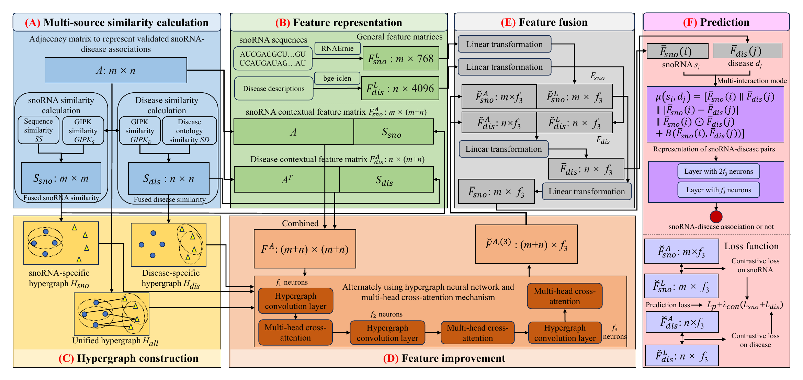

# SDAP-HNNA

SDAP-HNNA is a deep learning model for predicting snoRNA–disease associations. Three hypergraphs are constructed in this model for employing higher-order relationships among snoRNAs and among diseases, and binary associations between snoRNAs and diseases. A novel feature learning framework alternately leveraging hypergraph neural network and multi-head cross-attention is designed to generate high-level features.

<p align="center">
  
</p>

<p align="center"><em>Figure 1. Overall framework of SDAP-MHNN.</em></p>

The repository provides the model implementation, reproducible 10-fold cross-validation splits, and four normalized snoRNA–disease association datasets.

## Repository structure

```text
SDAP-MHNN/
├── main.py                    # Training and evaluation entry point
├── model.py                   # SDAP-MHNN architecture
├── train_eval.py              # Cross-validation, training, and metrics
├── data_utils.py              # Dataset loading and similarity fusion
├── entity_cv.py               # Entity-level split and sampling utilities
├── hypergraph.py              # Hypergraph construction
├── gipk.py                    # GIPK similarity calculation
├── visualization.py           # ROC, PR, and result visualization
├── utils.py                   # Runtime and reproducibility utilities
├── requirements.txt           # Python dependencies
├── CITATION.bib               # BibTeX records for the source publications
├── scripts/
│   └── run_benchmarks.py      # Runs the three external benchmark datasets
├── data/                      # Dataset A (main/raw dataset)
└── benchmarks/
    ├── psnod/                 # Dataset B
    ├── gbdtsvm/               # Dataset C
    └── gcnmf_sda/             # Dataset D
```

## Datasets

| Dataset | Directory | snoRNAs | Diseases | Known associations | Source publication |
|---|---|---:|---:|---:|---|
| Dataset A (GL4SDA-derived) | `data/` | 384 | 60 | 910 | GL4SDA [1] |
| Dataset B (PSnoD) | `benchmarks/psnod/` | 220 | 27 | 459 | PSnoD [2] |
| Dataset C (GBDTSVM) | `benchmarks/gbdtsvm/` | 335 | 112 | 1,010 | GBDTSVM [3] |
| Dataset D (GCNMF-SDA) | `benchmarks/gcnmf_sda/` | 307 | 54 | 780 | GCNMF-SDA [4] |

Each dataset directory contains the normalized inputs used by SDAP-MHNN:

| File | Description |
|---|---|
| `adj_index.csv` | Indexed snoRNA–disease association matrix |
| `sno_p2p_smith.csv` | snoRNA Smith–Waterman sequence-similarity matrix |
| `disease_do_similarity.csv` | Disease Ontology semantic-similarity matrix |
| `sno_rnaernie_emb.npy` | Precomputed RNAErnie snoRNA embeddings |
| `disease_feat_bgeicl.csv` | Precomputed disease text embeddings |
| `cv_splits_10fold_seed42.npz` | Reproducible 10-fold cross-validation split |
| `comparison_data_10fold_seed42.npz` | Shared fold data for cross-method comparisons |

The row and column order must remain aligned across the association matrix, similarity matrices, and embedding files.

## Installation

Create and activate a virtual environment, then install the dependencies:

```bash
python -m venv .venv
```

On Linux or macOS:

```bash
source .venv/bin/activate
python -m pip install --upgrade pip
pip install -r requirements.txt
```

On Windows PowerShell:

```powershell
.\.venv\Scripts\Activate.ps1
python -m pip install --upgrade pip
pip install -r requirements.txt
```

For GPU training, install the PyTorch build compatible with the local CUDA version before installing the remaining requirements. The pretrained embeddings required for the reported experiments are already included, so downloading RNAErnie or a disease language model is not required for ordinary training.

## Usage

### Run Dataset A

```bash
python main.py \
  --data_path data \
  --dataset_name raw_data \
  --output_dir results/raw_data \
  --n_splits 10 \
  --seed 42 \
  --mode fixed
```

PowerShell accepts the same command on one line:

```powershell
python main.py --data_path data --dataset_name raw_data --output_dir results/raw_data --n_splits 10 --seed 42 --mode fixed
```

### Run the three external benchmark datasets

```bash
python scripts/run_benchmarks.py --n_splits 10 --seed 42 --mode fixed
```

To run one benchmark only:

```bash
python scripts/run_benchmarks.py --datasets psnod --n_splits 10 --seed 42 --mode fixed
```

Available benchmark names are `psnod`, `gbdtsvm`, and `gcnmf_sda`.

### Hyperparameter search

Set `--mode grid` instead of `--mode fixed` to run the configured grid search. This is substantially more expensive than the fixed configuration.

## Outputs

Results are written under the requested output directory. Typical outputs include:

```text
HGNN_cv_results.csv
HGNN_selection_comparison.csv
cv_predictions.npz
comparison_data_10fold_seed42.npz
logs/
plots/
```

The `results/`, `outputs/`, log, cache, and checkpoint directories are excluded from Git by `.gitignore`.

## Reproducibility

- The default random seed is `42`.
- The repository includes the saved 10-fold splits used for evaluation.
- Use `--mode fixed` to run the predefined SDAP-MHNN configuration.
- Do not reorder identifiers or matrix rows and columns when replacing data files.
- Hardware and library versions can cause small numerical differences.

## Data sources and original publications

The normalized files in Dataset A were derived from the dataset released with GL4SDA [1]. Datasets B-D were normalized from the datasets released with PSnoD [2], GBDTSVM [3], and GCNMF-SDA [4], respectively. The normalization performed for this repository does not change the stated provenance of the original data.

When using the processed datasets, please cite the SDAP-MHNN work and the corresponding original publication:

1. Massimo La Rosa, Antonino Fiannaca, Isabella Mendolia, Laura La Paglia, and Alfonso Urso. "GL4SDA: Predicting snoRNA-disease associations using GNNs and LLM embeddings." *Computational and Structural Biotechnology Journal*, 27:1023-1033, 2025. [https://doi.org/10.1016/j.csbj.2025.03.014](https://doi.org/10.1016/j.csbj.2025.03.014)
2. Zijie Sun, Qinlai Huang, Yuhe Yang, Shihao Li, Hao Lv, Yang Zhang, Hao Lin, and Lin Ning. "PSnoD: identifying potential snoRNA-disease associations based on bounded nuclear norm regularization." *Briefings in Bioinformatics*, 23(4):bbac240, 2022. [https://doi.org/10.1093/bib/bbac240](https://doi.org/10.1093/bib/bbac240)
3. Ummay Maria Muna, Fahim Hafiz, Shanta Biswas, and Riasat Azim. "GBDTSVM: Combined Support Vector Machine and Gradient Boosting Decision Tree Framework for efficient snoRNA-disease association prediction." *Computers in Biology and Medicine*, 192:110219, 2025. [https://doi.org/10.1016/j.compbiomed.2025.110219](https://doi.org/10.1016/j.compbiomed.2025.110219)
4. Yaowu Zhang, Xiu Jin, and Xiaodan Zhang. "GCNMF-SDA: predicting snoRNA-disease associations based on graph convolution and non-negative matrix factorization." *Briefings in Bioinformatics*, 26(5):bbaf453, 2025. [https://doi.org/10.1093/bib/bbaf453](https://doi.org/10.1093/bib/bbaf453)

Machine-readable BibTeX records for all four publications are provided in [`CITATION.bib`](CITATION.bib).

## Citation

If you use this code or the processed datasets, please cite the accompanying SDAP-MHNN manuscript. The final BibTeX entry can be added here after publication.
